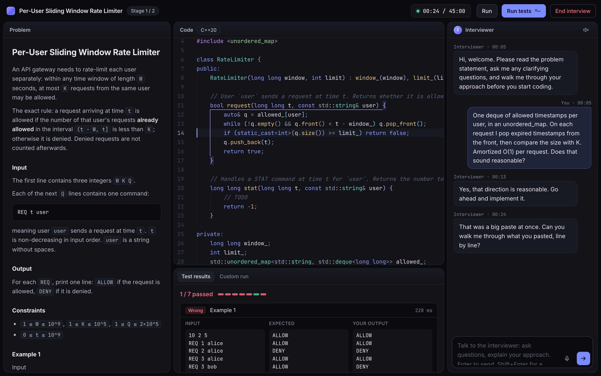
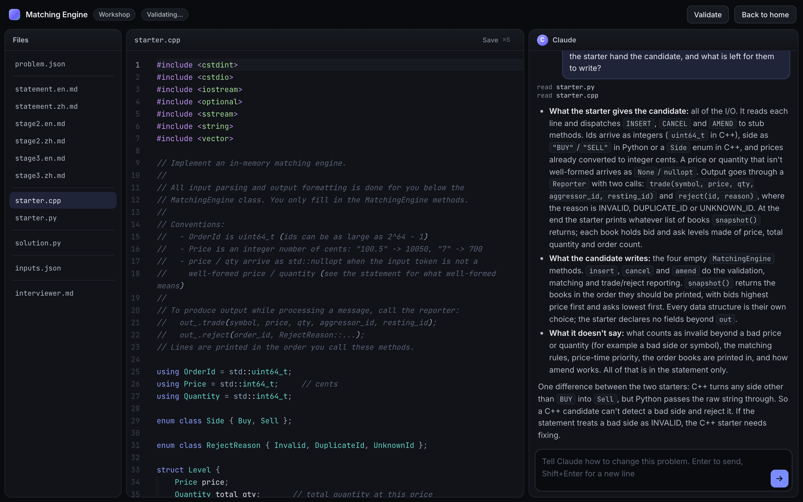
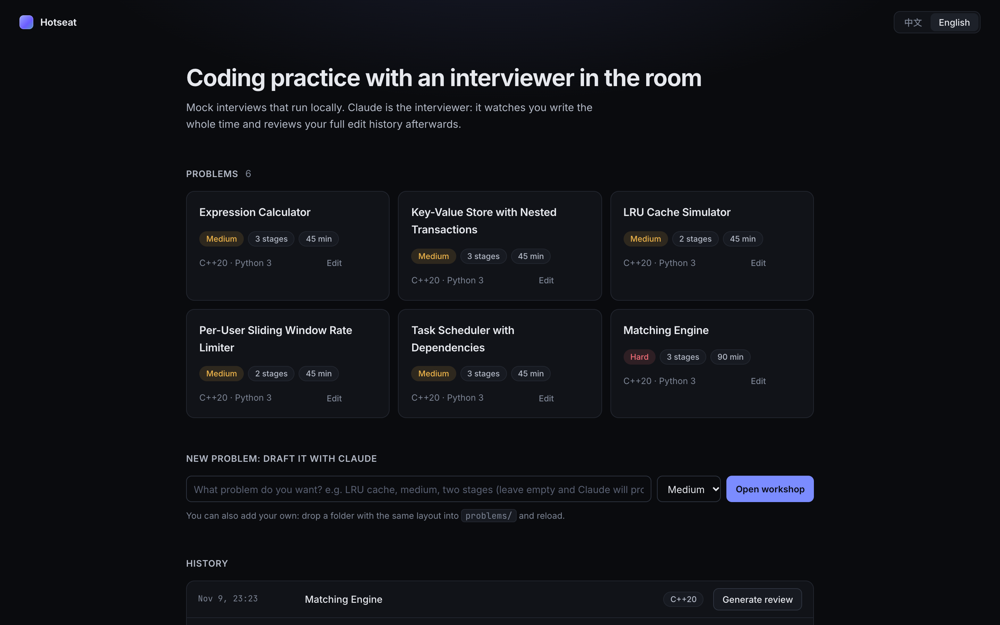

# Hotseat

**An AI interviewer that watches you code.** Hotseat runs mock coding interviews on your own machine. Claude plays the interviewer: it sees the problem and every change you make to your code, decides when to speak and when to stay quiet, reveals follow-up requirements in stages, and afterwards reviews how you actually wrote the solution, from your full edit history.

[中文说明](README.zh-CN.md)



## Why

Practising alone on a judge tells you whether your code passes. It does not tell you that you started typing before you had a plan, that you rewrote the same loop four times, or that you could not explain why your fix worked. A human mock interviewer does, but one is rarely available. Hotseat puts an LLM in that seat.

## What it does

- **Live interviewer.** It is woken when you ask something, run the tests, pause after writing, paste a large block, or stall, and then chooses between speaking and silence. It asks for your approach before you code, does not point out bugs it can see, and gives hints only in graded steps. Its rules are a plain Markdown file you can edit.
- **Shared editor.** The interviewer can type into your editor, as on a shared pad: a clarified rule, a small worked example, an interface it wants you to implement. Its lines are highlighted and logged separately from your edits, so the review does not count them as yours.
- **Staged requirements.** Problems have two or three stages. The interviewer reveals the next one when you finish the current one, as in a real onsite.
- **Local judge.** C++20 and Python 3 are compiled and run on your machine against public and hidden tests. Starter code handles all input and output; you write the logic.
- **Edit history and review.** Every keystroke delta, snapshot, test run, message and private interviewer note is logged. When you end the interview, a stronger model reads that history and writes a review with timestamps: where you hesitated, what you rewrote, how each bug got in and out.
- **Voice (optional).** Talk while you code. Speech is transcribed locally by whisper.cpp, primed with the identifiers in your code. The interviewer tells thinking aloud from questions addressed to it, and its replies can be read aloud.
- **Problem workshop.** Write and refine problems in a chat with Claude that edits the problem's files directly and validates them after each change.
- **English and Chinese** for the UI, statements, interviewer and review.



## Quick start

You need [Node.js](https://nodejs.org) 20.12 or newer, a C++ compiler or Python 3 (ideally both), and access to Claude (see [Claude access](#claude-access)).

```bash
npx github:EtoDemerzel0427/hotseat-ai
```

This starts the app and opens `http://localhost:4477`. Problems, sessions and settings are kept in `~/.hotseat-ai`.

Check your setup at any time:

```bash
npx github:EtoDemerzel0427/hotseat-ai doctor
```

### From a clone

```bash
git clone https://github.com/EtoDemerzel0427/hotseat-ai
cd hotseat-ai
npm install
cp .env.example .env      # optional
npm run doctor
npm start
```

Run this way, data stays inside the repository folder.

### Docker

For Windows, or if you prefer not to install compilers, or want candidate code confined to a container:

```bash
git clone https://github.com/EtoDemerzel0427/hotseat-ai
cd hotseat-ai
echo "ANTHROPIC_API_KEY=sk-ant-..." > .env
docker compose up --build
```

Then open `http://localhost:4477`. The image contains g++, Python, whisper.cpp and a speech model (about 1.5 GB). Data lives in the `data` volume.

Two things differ from running natively:

- A container cannot use a Claude Code login from the host, so an API key is required.
- Speech-to-text runs on the CPU. On an Apple Silicon Mac it is several times slower than the native Metal build.

## Claude access

Hotseat talks to Claude through the [Claude Agent SDK](https://docs.claude.com/en/api/agent-sdk/overview), which resolves credentials itself:

| Method | How |
|---|---|
| API key | Put `ANTHROPIC_API_KEY=...` in `.env`. Billed per use. |
| Amazon Bedrock, Google Vertex AI | Set the usual Claude Code variables, e.g. `CLAUDE_CODE_USE_BEDROCK=1`. |
| Claude Code login | If no key is set and Claude Code is logged in on this machine, the SDK uses that login. |

Check Anthropic's current terms for which of these fits your use. `LIVE_MODEL` (default `sonnet`) drives the live interviewer; `DEEP_MODEL` (default `opus`) writes reviews and powers the workshop.

A 45-minute interview makes a few dozen short calls to the live model and one long call for the review.

## Voice

Voice is optional. Without it everything works through the chat box.

**Speech-to-text** uses [whisper.cpp](https://github.com/ggml-org/whisper.cpp), entirely on your machine:

```bash
npx github:EtoDemerzel0427/hotseat-ai setup-voice          # from a clone: npm run setup:voice
```

The script tells you how to install `whisper-server` for your platform (`brew install whisper-cpp` on macOS) and downloads a model: `turbo` (547 MB, the default on Apple Silicon), `small` (181 MB) or `base` (57 MB). Use Chrome or Safari, allow the microphone, and wear headphones so the interviewer's voice is not picked up.

**Text-to-speech** is chosen with `TTS_PROVIDER`:

| Value | What it is |
|---|---|
| `edge` (default) | The endpoint behind Microsoft Edge's read-aloud feature. Free and good, but unofficial: it needs internet and may stop working. |
| `openai` | Any service with an OpenAI-compatible `/audio/speech` endpoint. Set `TTS_OPENAI_API_KEY`, and `TTS_OPENAI_BASE_URL` for other providers. |
| `say` | The macOS `say` command. Fully local. |
| `off` | Text only. |

## Configuration

Everything is set in `.env`; [`.env.example`](.env.example) lists every option with its default. The file is read from the current directory and from the data directory.

Two Markdown files control behaviour and are meant to be edited:

- `prompts/interviewer.md`: when the interviewer speaks, what it never does, how hints escalate, what happens when a stage is finished.
- `prompts/author.md`: the standards the workshop holds problems to.

## Problems

Six problems are included: a matching engine (hard, three stages, 90 minutes), a per-user rate limiter, an LRU cache, a key-value store with nested transactions, an expression calculator and a task scheduler.

To add your own, use **New problem** on the home page, or **Edit** on any existing one. A problem is a folder:

```
problems/<slug>/
  problem.json                      title (zh, en), difficulty, minutes, stage list
  statement.en.md, statement.zh.md  stage 1
  stage2.en.md, stage2.zh.md        one pair per later stage
  starter.cpp, starter.py           starter code that owns all I/O
  solution.py                       reference solution; expected outputs are generated from it
  inputs.json                       test inputs: name, stage, hidden
  interviewer.md                    notes for the interviewer: approach, pitfalls, follow-ups, hint ladder
```

Validate a problem from the command line with `npm run check -- <slug>`.



## Security

Hotseat is a local, single-user tool. Keep it on `localhost`.

- Code you submit is compiled and run on your machine with a time limit and no sandbox. Use Docker if you want isolation.
- In the workshop, Claude can read and write files inside the problem's folder and run short Python scripts there.
- The server binds to `127.0.0.1` and has no authentication.

## Status

Developed and used on macOS (Apple Silicon). The Docker image has been tested for judging, speech-to-text and text-to-speech. Native Linux should work but has had little testing; native Windows is untested, so use Docker there.

## License

[MIT](LICENSE). Bundled fonts (Inter, JetBrains Mono) are under the SIL Open Font License; the Monaco editor and whisper.cpp are MIT.
