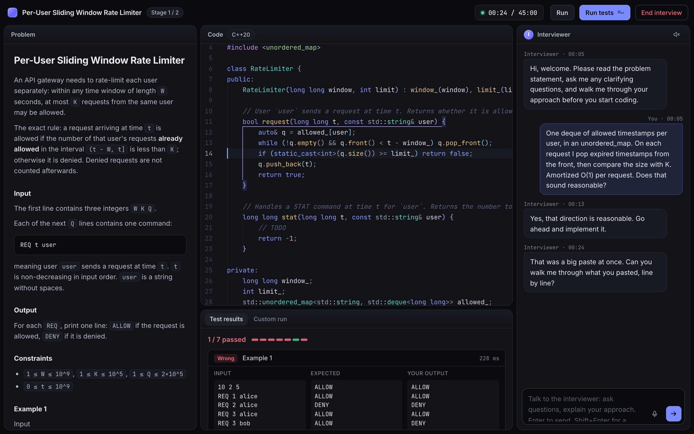
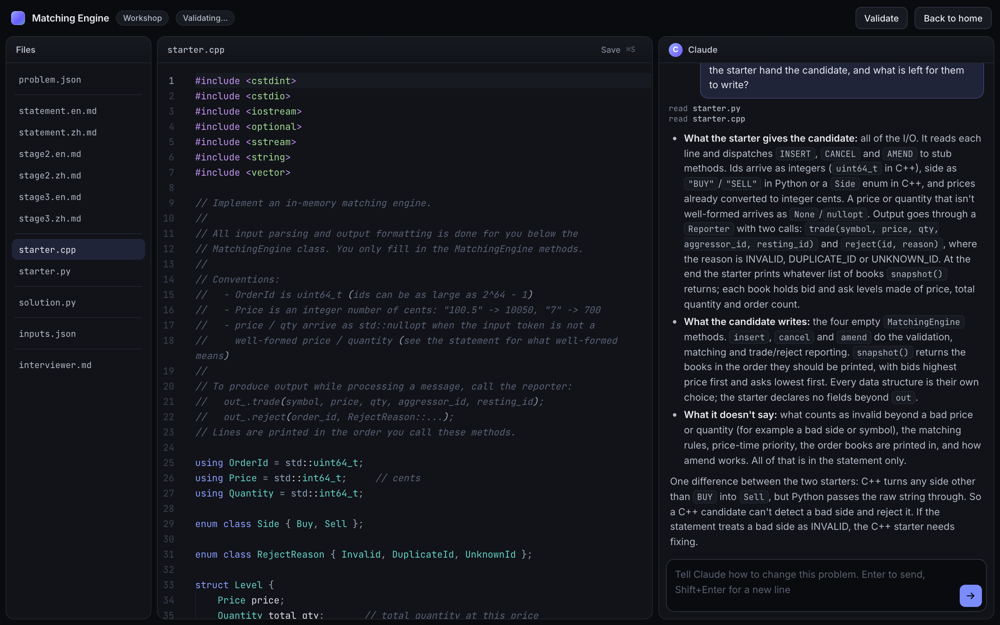
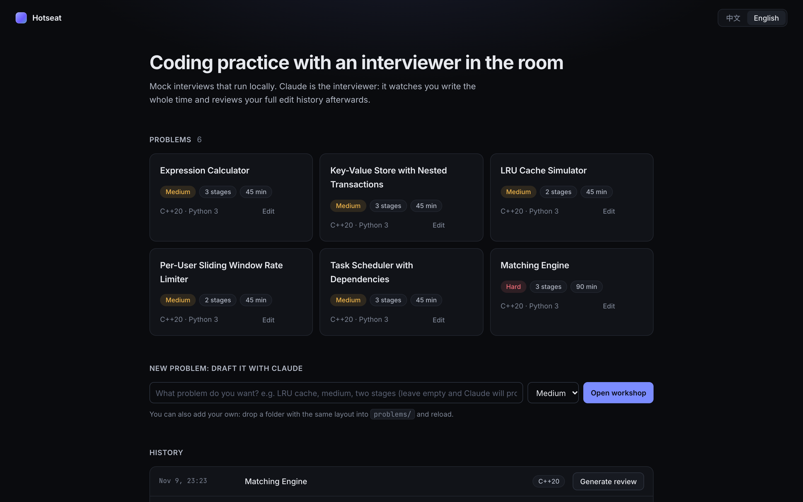

# Hotseat

**一个看着你写代码的 AI 面试官。** Hotseat 在你自己的机器上运行模拟编码面试。面试官由 Claude 担任：它能看到题目和你对代码的每一次改动，自己决定什么时候开口、什么时候保持沉默，分阶段放出后续需求，结束后根据完整的改动历史复盘你写代码的过程。

[English](README.md)



## 为什么做这个

一个人在判题平台上练习，只能知道代码过没过。它不会告诉你：你没想清楚就开始写了，同一个循环重写了四遍，改对了却说不出为什么。真人模拟面试官能指出这些，但不容易找到。Hotseat 让 LLM 来坐这个位置。

## 功能

- **实时面试官**：你提问、运行测试、写完一段停下来、粘贴大段代码、长时间没有进展时，它会被叫醒，然后决定说话还是沉默。它会先让你讲思路，看到 bug 不提醒，提示按级别逐步给。这些规则写在一个可以编辑的 Markdown 文件里。
- **分阶段需求**：每道题有两到三个阶段，完成当前阶段后面试官放出下一个，和真实的现场面试一样。
- **本地判题**：C++20 和 Python 3 在本机编译运行，有公开用例和隐藏用例。起始代码负责全部输入输出，你只写逻辑。
- **改动历史与复盘**：每次按键的增量、快照、测试运行、对话和面试官的私下笔记都会记录。面试结束后，由更强的模型读这份历史写复盘，带时间点：哪里犹豫、哪里反复改、每个 bug 是怎么引入又怎么修掉的。
- **语音（可选）**：边写边说。语音由本机的 whisper.cpp 转写，并用你代码里的标识符作提示词。面试官会区分自言自语和对它说的话，它的回复可以朗读出来。
- **题目工作台**：和 Claude 对话来写题、改题，它直接修改题目文件，每次改完自动校验。
- **中英文**：界面、题面、面试官、复盘都支持。



## 快速开始

需要 [Node.js](https://nodejs.org) 20.12 或更新版本、C++ 编译器或 Python 3（最好都有），以及 Claude 的访问方式（见[接入 Claude](#接入-claude)）。

```bash
npx github:EtoDemerzel0427/hotseat-ai
```

应用启动后会打开 `http://localhost:4477`。题目、面试记录和设置保存在 `~/.hotseat-ai`。

随时可以检查环境：

```bash
npx github:EtoDemerzel0427/hotseat-ai doctor
```

### 从源码运行

```bash
git clone https://github.com/EtoDemerzel0427/hotseat-ai
cd hotseat-ai
npm install
cp .env.example .env      # 可选
npm run doctor
npm start
```

这种方式下数据保存在仓库目录里。

### Docker

适用于 Windows，或者不想安装编译器、希望把候选人代码关在容器里的情况：

```bash
git clone https://github.com/EtoDemerzel0427/hotseat-ai
cd hotseat-ai
echo "ANTHROPIC_API_KEY=sk-ant-..." > .env
docker compose up --build
```

然后打开 `http://localhost:4477`。镜像里有 g++、Python、whisper.cpp 和一个语音模型，约 1.5 GB。数据保存在 `data` 卷里。

和本机运行相比有两点不同：

- 容器用不了宿主机上的 Claude Code 登录，必须提供 API key。
- 语音识别只能用 CPU。在 Apple 芯片的 Mac 上比本机的 Metal 版本慢好几倍。

## 接入 Claude

Hotseat 通过 [Claude Agent SDK](https://docs.claude.com/en/api/agent-sdk/overview) 调用 Claude，凭据由 SDK 自己解析：

| 方式 | 做法 |
|---|---|
| API key | 在 `.env` 里写 `ANTHROPIC_API_KEY=...`，按量计费 |
| Amazon Bedrock、Google Vertex AI | 设置 Claude Code 的对应变量，例如 `CLAUDE_CODE_USE_BEDROCK=1` |
| Claude Code 登录 | 没有设置 key 且本机已登录 Claude Code 时，SDK 会使用这个登录 |

哪种方式适合你的用途，请以 Anthropic 当前的条款为准。`LIVE_MODEL`（默认 `sonnet`）用于实时面试官，`DEEP_MODEL`（默认 `opus`）用于复盘和工作台。

一场 45 分钟的面试会对实时模型发起几十次短调用，再加一次较长的复盘调用。

## 语音

语音是可选的，不装也可以完全用文字进行。

**语音识别**使用 [whisper.cpp](https://github.com/ggml-org/whisper.cpp)，完全在本机运行：

```bash
npx github:EtoDemerzel0427/hotseat-ai setup-voice          # 从源码运行时：npm run setup:voice
```

脚本会告诉你当前平台怎样安装 `whisper-server`（macOS 上是 `brew install whisper-cpp`），并下载模型：`turbo`（547 MB，Apple 芯片上的默认选项）、`small`（181 MB）或 `base`（57 MB）。请用 Chrome 或 Safari 打开页面并允许使用麦克风，建议戴耳机，避免面试官的声音被录进去。

**朗读**由 `TTS_PROVIDER` 选择：

| 取值 | 说明 |
|---|---|
| `edge`（默认） | 微软 Edge 朗读功能背后的接口。免费、音质好，但不是官方开放的接口：需要联网，可能失效 |
| `openai` | 任何兼容 OpenAI `/audio/speech` 的服务。设置 `TTS_OPENAI_API_KEY`，其他服务商再设置 `TTS_OPENAI_BASE_URL` |
| `say` | macOS 自带的 `say` 命令，完全本地 |
| `off` | 只显示文字 |

## 配置

所有选项都在 `.env` 里设置，[`.env.example`](.env.example) 列出了每一项和默认值。程序会读取当前目录和数据目录下的 `.env`。

有两个 Markdown 文件决定行为，可以直接修改：

- `prompts/interviewer.md`：面试官什么时候开口、哪些事不做、提示怎么升级、一个阶段完成后做什么。
- `prompts/author.md`：工作台写题时遵循的标准。

## 题库

自带六道题：撮合引擎（困难，三个阶段，90 分钟）、按用户的限流器、LRU 缓存、支持嵌套事务的键值存储、表达式计算器、任务调度。

添加自己的题目：首页的“新题”，或任意一道题上的“编辑”。一道题是一个目录：

```
problems/<slug>/
  problem.json                      标题（中、英）、难度、时长、阶段列表
  statement.en.md, statement.zh.md  第一阶段题面
  stage2.en.md, stage2.zh.md        后续每个阶段一对
  starter.cpp, starter.py           起始代码，负责全部输入输出
  solution.py                       参考解，期望输出由它生成
  inputs.json                       测试输入：名称、阶段、是否隐藏
  interviewer.md                    面试官备注：解法、常见错误、追问、分级提示
```

命令行校验一道题：`npm run check -- <slug>`。



## 安全

Hotseat 是本地的单用户工具，请只在 `localhost` 上使用。

- 你提交的代码在本机编译运行，有时间限制，没有沙箱。需要隔离请用 Docker。
- 在工作台里，Claude 可以读写题目目录内的文件，并在其中运行简短的 Python 脚本。
- 服务只监听 `127.0.0.1`，没有身份验证。

## 现状

在 macOS（Apple 芯片）上开发和使用。Docker 镜像测试过判题、语音识别和朗读。Linux 本机运行应该可用，但测试很少；Windows 本机运行没有测试过，请使用 Docker。

## 许可证

[MIT](LICENSE)。自带的字体（Inter、JetBrains Mono）使用 SIL Open Font License；Monaco 编辑器和 whisper.cpp 使用 MIT。
